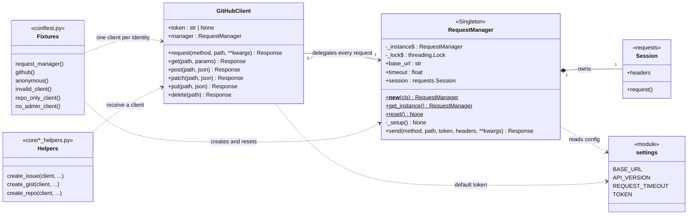
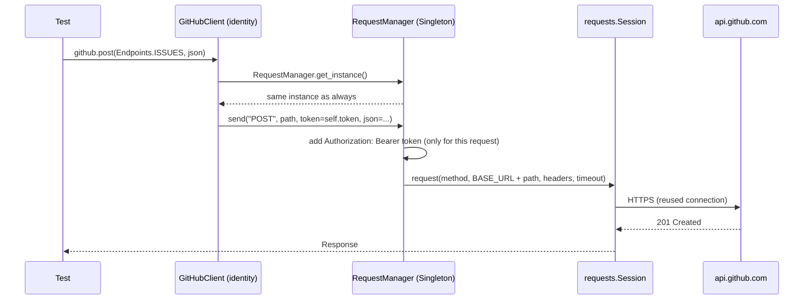

# Request manager (Singleton)

`core/request_manager.py` is the only place of the framework that talks to `requests`.
It follows the **Singleton** pattern: there is one `RequestManager` per test run, and every
module (Issues, Gists, Repositories, Labels and Milestones) sends its requests through it.

## Why a Singleton here

- **One connection pool.** Before, each `GitHubClient` opened its own `requests.Session`
  (3 in `tests/conftest.py` and 2 more in `tests/repositories/conftest.py`). Now the whole run
  shares one session, so TCP/TLS connections to `api.github.com` are reused.
- **One place for the shared configuration.** Base URL, `Accept`, `X-GitHub-Api-Version` and the
  timeout (`REQUEST_TIMEOUT` in `.env`) are set once, from `config/settings.py`.
- **One place to hook cross-cutting features** (for example the logger of Activity 3):
  every request of every module goes through `RequestManager.send()`.

## Design decisions

| Decision | Reason |
|---|---|
| The instance is created in `__new__`, with a class attribute `_instance` | `RequestManager()` and `RequestManager.get_instance()` always return the same object |
| The session is built in `_setup()`, not in `__init__` | Python calls `__init__` on every `RequestManager()`; `_setup()` runs only once |
| Double-checked locking with `threading.Lock` | Two threads cannot create two instances (safe if we add parallel runs later) |
| The token is **not** stored in the Singleton | The auth tests need several identities in the same run (valid, invalid, anonymous, repo-only, no-admin). The token travels with each request |
| `GitHubClient` keeps its public methods (`get`, `post`, `patch`, `put`, `delete`) | No test or helper had to change: a client is now an identity that delegates to the Singleton |
| `RequestManager.reset()` | Closes the session after the last test (`request_manager` fixture) and lets the unit tests start from a clean instance |

## Class diagram



## Sequence: one request



## How to use it

```python
from core.api_client import GitHubClient

github = GitHubClient()                 # token from .env
anonymous = GitHubClient(token=None)    # no Authorization header
response = github.get(Endpoints.ISSUES, params={"state": "open"})
```

Tests normally receive the clients from the fixtures (`github`, `anonymous`, `invalid_client`).
Do not create `requests.Session()` or call `requests.get()` in tests or helpers: use a client,
so the request goes through the Singleton. The only exception are the proofs of concept in `tests/poc/`.

The unit tests of the pattern are in `tests/core/test_request_manager.py` and do not need a token:

```
pytest tests/core
```
